# CHESS LEGENDS: ARCANE WARS

A fantasy chess game for the Game Boy Advance. Play complete, rules-accurate chess, or **Arcane Chess**: the
same game plus a mana resource and six magical abilities that reposition pieces without ever capturing. Restore
the shattered Crown of Six across six kingdoms in a story campaign, solve proven tactical puzzles, face every
ruler in a row in the Boss Gauntlet, or play a friend on one console.

**The ROM: [`release/ChessLegends.gba`](release/ChessLegends.gba)**. Play it in mGBA or another GBA emulator,
or on a flash cartridge; nothing needs to be compiled.

| | | |
|---|---|---|
| 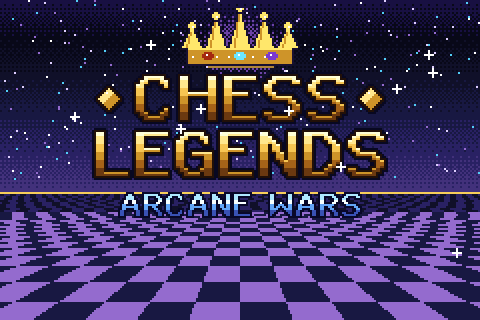 | 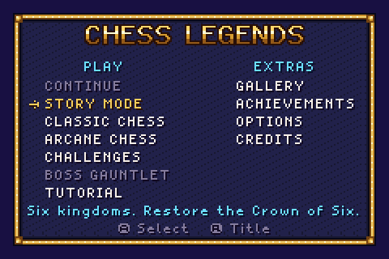 | 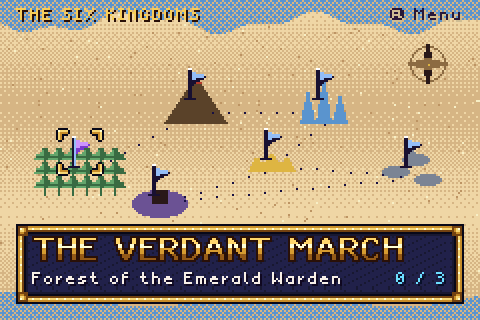 |
| 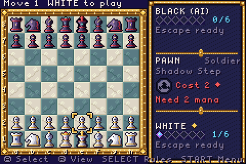 | 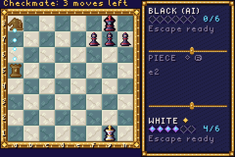 | 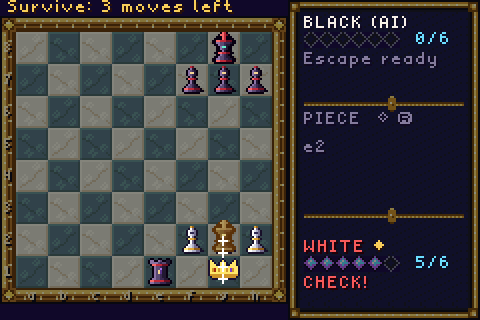 |
| 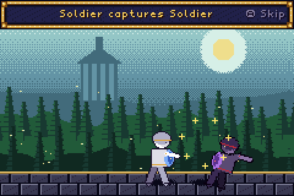 | 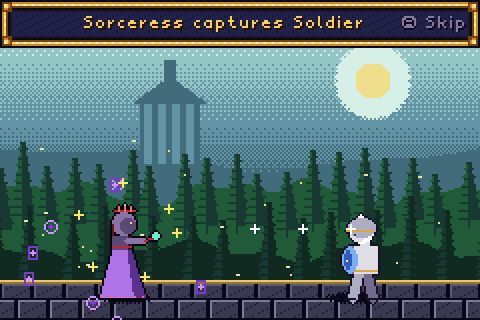 | 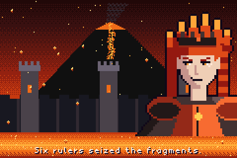 |
| 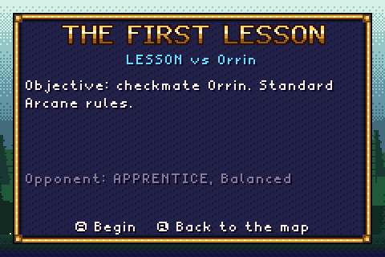 | 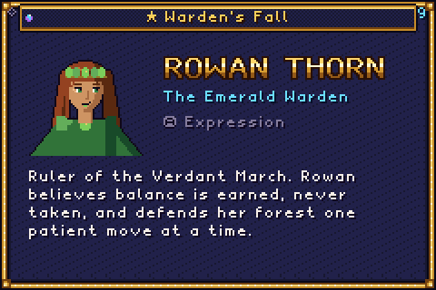 | 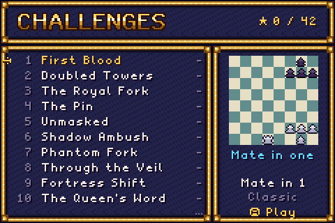 |

## The game

* **Classic Chess**: castling, en passant, promotion and underpromotion, check, checkmate, stalemate, threefold and
  fivefold repetition, the fifty and seventy-five move rules, dead positions. Verified against 36 perft reference
  positions.
* **Arcane Chess**: each player gains 1 mana per turn (up to 6). A turn is either a normal move or one spell:
  * **Shadow Step** (pawn, 2 mana): one square sideways.
  * **Phase Shift** (knight, 3 mana): onto any adjacent square.
  * **Ghost Walk** (bishop, 3 mana): along a diagonal through one friendly piece.
  * **Castle Swap** (rook, 4 mana): exchanges places with a nearby friendly bishop or knight.
  * **Royal Command** (queen, 5 mana): moves an adjacent ally one step.
  * **Royal Escape** (king, 5 mana, once per game, only in check): a two-square leap.

  Spells never capture; checkmate still decides the game. The complete rules are in [docs/RULES.md](docs/RULES.md).
* **Captures as duels**: every capture can play as a short side-view battle between the two pieces' fantasy
  classes, with six attack styles and five defeat reactions. Every spell has its own board effect. Animations can
  be full, fast, minimal or off, and any of them can be skipped.
* **A real opponent**: a negamax alpha-beta search with four difficulties (Apprentice, Knight, Sorcerer,
  Grandmaster) and seven personalities. It plays by the same rules as you, with no hidden bonuses and no
  scripted wins ([docs/AI_DESIGN.md](docs/AI_DESIGN.md)).

## Modes

| Mode | Contents |
|---|---|
| Story | 6 kingdoms, 18 encounters (lessons, trials and six boss duels), dialogue with portraits, boss introductions, an opening and an ending cinematic |
| Classic Chess / Arcane Chess | against the computer (choice of side, difficulty, board) or two players on one console |
| Challenges | 14 tactical puzzles, each proven solvable by exhaustive search, with bronze, silver and gold medals |
| Boss Gauntlet | the six rulers in a row; one defeat ends the run (unlocked by the campaign) |
| Tutorial | 10 interactive lessons, from moving the cursor to every spell |
| Gallery, Achievements, Options, Credits | 39 gallery entries, 32 achievements, statistics, audio and animation settings |

## Controls

| Button | Action |
|---|---|
| D-Pad | move the cursor, navigate menus |
| A | select a piece, confirm a move or a menu entry, skip an animation |
| B | cancel, go back |
| L | switch the selected piece between normal moves and its spell |
| R | cycle the side panel: piece, threats, game summary |
| SELECT | the rule card of the piece under the cursor |
| START | pause menu (resume, settings, rules, hint, draws, save & quit, resign, quit) |

## Saving

The game saves automatically to battery-backed cartridge SRAM: settings, campaign progress, medals, achievements,
statistics, and a suspended match ("SAVE & QUIT" in the pause menu, then CONTINUE in the main menu). Each record is
versioned and checksummed, and written alternately to two slots, so an interrupted write never loses the last
good save; a damaged save is repaired from its backup copy and reported on the title screen. Emulators store
the save in a `.sav` file next to the ROM.

## Building

The ROM is rebuilt with devkitARM and Butano; the art and music are regenerated by Python scripts in
`assets_source/`. On Windows:

```powershell
.\build.ps1           # assets + ROM -> release\ChessLegends.gba
.\build.ps1 verify    # tests, puzzle proofs, warning-free build, ROM inspection, emulator scenarios
```

Requirements, every command and the project layout: [docs/BUILDING.md](docs/BUILDING.md).

## Documentation

* [docs/RULES.md](docs/RULES.md): the complete rules, precise enough to reimplement the game
* [docs/ARCHITECTURE.md](docs/ARCHITECTURE.md): how the code is organized
* [docs/AI_DESIGN.md](docs/AI_DESIGN.md): search, evaluation, difficulties, performance
* [docs/ART_DIRECTION.md](docs/ART_DIRECTION.md) and [docs/AUDIO_DESIGN.md](docs/AUDIO_DESIGN.md): the
  original art and music, and how they are generated
* [docs/BALANCE_REPORT.md](docs/BALANCE_REPORT.md): 3020 simulated games and what they show
* [docs/TEST_REPORT.md](docs/TEST_REPORT.md): every test that was run and its result

## Known limitations

* Verified in the mGBA emulator (headless, scripted, and the regular player), not on real hardware.
* The computer needs time at the higher levels: on the console about 0.4 s (Apprentice), 2 s (Knight), 5 s
  (Sorcerer) and 8 s (Grandmaster) for a middlegame move. The interface keeps running at 60 fps meanwhile.
* The computer rarely uses Castle Swap and Royal Command; both are situational tools (see the balance report).
* The art and music are generated by code. They are original and complete, but the battle characters are small
  (64x64 sprites) and simply drawn.
* English only. Local two-player play shares one console (no link cable).
* Loading a scene takes one or two frames while the screen is black.

## Credits

Design, code, art and music: generated for this project; every asset is original and produced by the scripts in
`assets_source/`. Engine: [Butano](https://github.com/GValiente/butano) (zlib license). Toolchain: devkitARM.
Testing: [mGBA](https://mgba.io) (libmgba, MPL 2.0).
